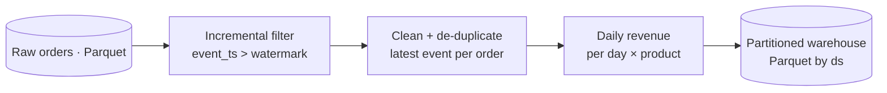

# spark-batch-pipeline — PySpark distributed batch ETL

> A **PySpark** batch pipeline that reads raw order events, **cleans and
> de-duplicates** them, applies **incremental (watermark) loading**, aggregates
> **daily revenue per product**, and writes a **date-partitioned** warehouse. The
> transforms are pure DataFrame functions, unit-tested on a local Spark session.


> ℹ️ An **original reference implementation** of distributed batch data
> engineering. No proprietary code or data.

---

## Pipeline



- **Incremental loading** — only events newer than a watermark are processed, so
  each run is cheap and idempotent against the partitioned output.
- **Clean + de-duplicate** — drops null keys, non-positive amounts and unknown
  statuses, then keeps the **latest event per order** via a window function
  (handles replays / late updates).
- **Daily aggregates** — revenue and distinct order counts per day and product.
- **Partitioned output** — written Parquet partitioned by date (the same layout
  used for BigQuery partitioned/clustered tables via the connector in
  production), keeping date-filtered reads and incremental loads efficient.

## Why these choices

- **Transforms are pure `DataFrame -> DataFrame`** ([`transforms.py`](src/batch/transforms.py)),
  so the window/dedup/aggregation logic — the part worth getting right — is unit
  tested without any storage.
- **Window-function dedup over `dropDuplicates`** — keeps the *latest* record,
  not an arbitrary one.
- **Explicit input schema** — a malformed file fails loudly instead of inferring
  wrong types.

---

## Run it

```bash
pip install -e ".[dev]"

# in-memory demo (no storage needed) — clean + de-dupe + daily revenue:
python -m batch demo

# a real batch over Parquet, incremental since a watermark:
python -m batch run --input ./data/orders --output ./warehouse/daily_revenue \
  --watermark "2026-01-01 00:00:00"
```

## Tests

```bash
pytest -q
```
Covers window-function de-duplication (latest wins), cleaning (invalid rows
dropped), incremental watermark filtering, daily-revenue aggregation, and schema
validation. Test DataFrames are built with `spark.sql` (JVM-side), so the suite
runs on a local Spark session on any OS — no cluster, no object store.

---

*An original reference implementation. No proprietary code, data, or confidential information is included.*
